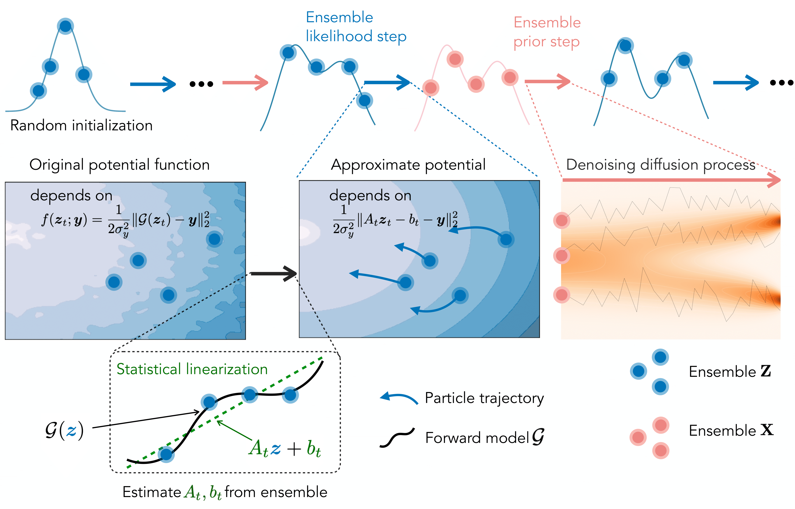

# Blade: A Derivative-free Bayesian Inversion Method using Diffusion Priors

[](https://arxiv.org/abs/2510.10968)
[](https://opensource.org/licenses/MIT)

This is the official implementation of **Blade**, a derivative-free Bayesian inversion method that leverages diffusion model priors for solving inverse problems.

## Abstract

Derivative-free Bayesian inversion is an important task in many science and engineering applications, particularly when computing the forward model derivative is computationally and practically challenging. Blade produces accurate and well-calibrated posteriors for Bayesian inversion using an ensemble of interacting particles. It leverages powerful data-driven priors based on diffusion models and can handle nonlinear forward models that permit only black-box access (i.e., derivative-free).

<p align="center">
  
</p>


## Installation

We recommend Linux with Python 3.10+ for the best compatibility. Use `uv sync` to install the dependencies.

## Pretrained Models

This codebase uses pretrained diffusion models from [InverseBench](https://github.com/Zhengyu-Huang/InverseBench). Please download the checkpoints from InverseBench and place them in the `checkpoints/` directory.

## How to run experiments

### Examples: Navier-Stokes Inverse Problems
```bash
python main.py algorithm=blade \
    algorithm.method.num_steps=25 \
    algorithm.method.likelihood_steps=50 \
    algorithm.method.guidance_scale=30.0 \
    problem.model.sigma_noise=1.0
```

`scripts/ns.sh` contains the commands to run Blade on Navier-Stokes.

### Examples: Linear Gaussian and Gaussian Mixture Problems

```bash
# Linear Gaussian with Blade
python gaussian.py algorithm=blade_gaussian

# Gaussian Mixture with Blade
python gmm-exp.py algorithm=blade_gmm
```

### Configuration

The project uses [Hydra](https://hydra.cc/) for configuration management. Configuration files are located in `configs/`:

- `configs/config.yaml` - Main configuration with defaults
- `configs/algorithm/` - Algorithm-specific configs (blade.yaml, enkg.yaml, etc.)
- `configs/pretrain/` - Pretrained model configs
- `configs/problem/` - Problem-specific configs

Override any configuration from the command line:
```bash
python main.py algorithm=blade algorithm.method.num_steps=50 problem.model.sigma_noise=0.5
```

## Citation

If you find this code useful, please cite our paper:

```bibtex
@article{zheng2025blade,
  title={Blade: A Derivative-free Bayesian Inversion Method using Diffusion Priors},
  author={Zheng, Hongkai and Wang, Austin and Wu, Zihui and Huang, Zhengyu and Baptista, Ricardo and Yue, Yisong},
  journal={arXiv preprint arXiv:2510.10968},
  year={2025}
}
```

## Acknowledgments

This codebase is built upon [InverseBench](https://github.com/Zhengyu-Huang/InverseBench). We thank the authors for their excellent work and for making their code publicly available.

## License

This project is licensed under the MIT License - see the [LICENSE](LICENSE) file for details.
